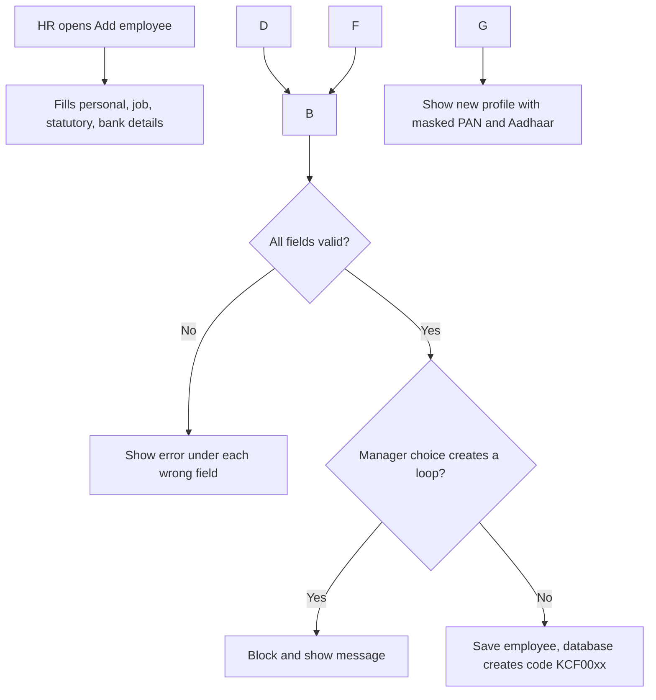
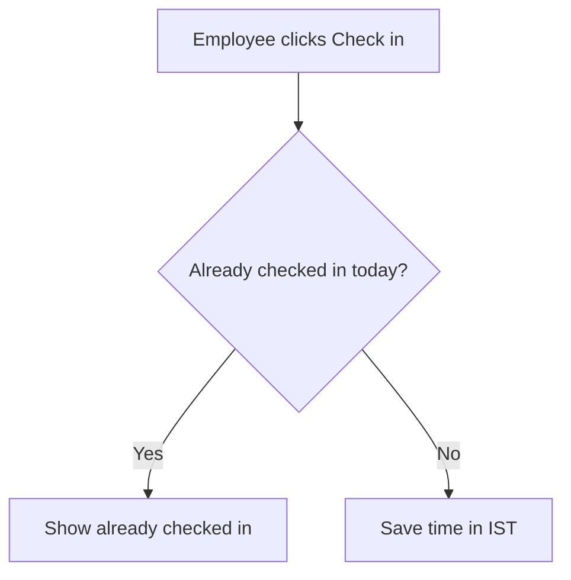
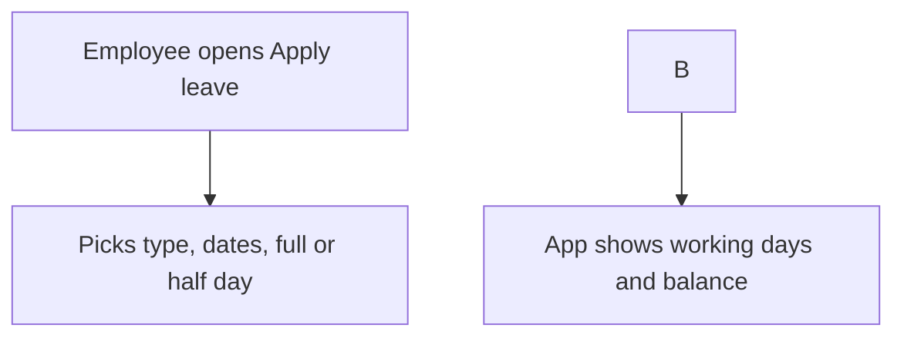
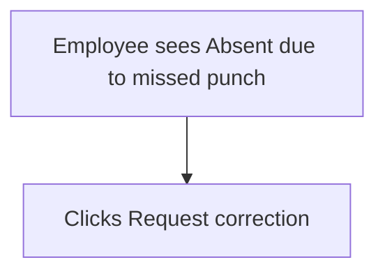

\# DESIGN.md — Konkan Coastal Foods HRMS

Author: Vishal Toraskar

Status: Draft (awaiting faculty sign-off)

\## 1. Product name and logo

Name: something short. Ideas to spark your own: KonkanHR, Sagar HR, TidePeople, or anything you like.

Why this name: one line.

Logo idea: one line describing it (e.g. “a wave inside a circle, in teal”). You’ll make the actual logo later with a free tool like Canva.

\## 2. User flows

\### 2.1 Add employee

\### 2.2 Check-in to day status

\### 2.3 Apply leave to approval to balance update

\### 2.4 Missed punch to regularisation

\## 3. Design system

\### Colour palette

| Role | Colour name | Hex | Used for |

|---|---|---|---|

| Primary | | | Main buttons, links, header |

| Secondary | | | Highlights, selected tabs |

| Background | | | Page background |

| Text | | | Normal text |

| Border | | | Card and table borders |

\### Status colours

| Status | Colour | Hex | Badge text |

|---|---|---|---|

| Present | | | P |

| Half Day | | | HD |

| Absent | | | A |

| On Leave | | | L |

| Holiday | | | H |

| Weekly Off | | | WO |

| Late | | | Late |

\### Typography

Page title \_\_24\_px, Section heading \_\_20\_px, Body text \_14\_\_px, Small text \_12\_\_px.

\### Spacing

“Spacing uses steps of 4px: 4, 8, 12, 16, 24, 32.”

\### Components

Button: primary, secondary, disabled

Card: e.g. a leave balance card

Table: header style, row hover

Form field with error: where the red message appears

Status badge: small rounded label using the status colours

\## 4. Wireframes

\### Desktop screens

\#### 1. Home dashboard

!\[Dashboard](docs/wireframes/01-dashboard.png)

\#### 2. My profile

!\[Profile](docs/wireframes/02-profile.png)

\#### 3. Employee directory

!\[Directory](docs/wireframes/03-directory.png)

\#### 4. Add / edit employee

!\[Add employee](docs/wireframes/04-add-employee.png)

\#### 5. My attendance

!\[My attendance](docs/wireframes/05-my-attendance.png)

\#### 6. Team attendance

!\[Team attendance](docs/wireframes/06-team-attendance.png)

\#### 7. Apply leave

!\[Apply leave](docs/wireframes/07-apply-leave.png)

\#### 8. My leave

!\[My leave](docs/wireframes/08-my-leave.png)

\#### 9. Approvals inbox

!\[Approvals](docs/wireframes/09-approvals.png)

\#### 10. Leave calendar

!\[Leave calendar](docs/wireframes/10-leave-calendar.png)

\#### 11. Ask HR

!\[Ask HR](docs/wireframes/11-ask-hr.png)

\#### 12. Settings

!\[Settings](docs/wireframes/12-settings.png)

\#### 13. Reports

!\[Reports](docs/wireframes/13-reports.png)

\### Phone layouts (Check-in, Apply leave)

\#### Phone: Check-in

!\[Phone check-in](docs/wireframes/p1-checkin-phone.png)

\#### Phone: Apply leave

!\[Phone apply leave](docs/wireframes/p2-apply-leave-phone.png)

\## 5. Empty, loading and error states

\### Dashboard

\### Approvals inbox

\### Reports

