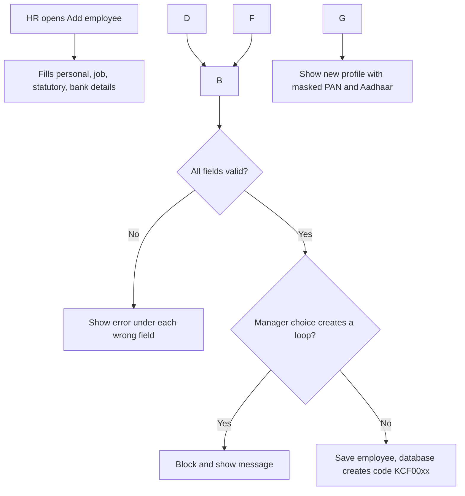
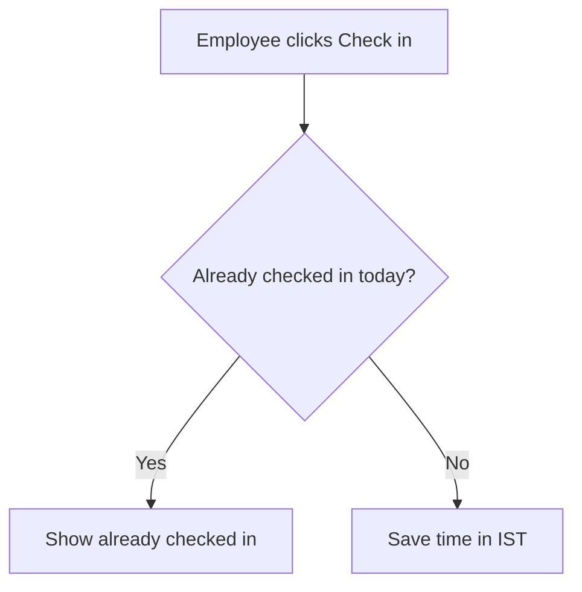

\# DESIGN.md — Konkan Coastal Foods HRMS

Author: Vishal Toraskar

Status: Draft (awaiting faculty sign-off)

\## 1. Product name and logo

Name: something short. Ideas to spark your own: KonkanHR, Sagar HR, TidePeople, or anything you like.

Why this name: one line.

Logo idea: one line describing it (e.g. “a wave inside a circle, in teal”). You’ll make the actual logo later with a free tool like Canva.

\## 2. User flows

\### 2.1 Add employee

\### 2.2 Check-in to day status

\### 2.3 Apply leave to approval to balance update

\### 2.4 Missed punch to regularisation

\## 3. Design system

\### Colour palette

\### Status colours

\### Typography

\### Spacing

\### Components

\## 4. Wireframes

\### Desktop screens

\### Phone layouts (Check-in, Apply leave)

\## 5. Empty, loading and error states

\### Dashboard

\### Approvals inbox

\### Reports

